<h1 align="center">Ciao, sono Daniele 👋</h1>

  <b>Solution Architect & Staff Engineer</b> 
  🏛️ Solution Architect by day · 🐉 D&D Player by night · da Palermo, a Milano 🇮🇹

  
  

---

### 🛠️ Stack

  
  
  
  
  
  
  
  
  
  
  
  
  

### 🔭 Su cosa lavoro

- Disegno di una target architecture event-driven e costruzione del core architecture team
- Migrazione dai monoliti legacy con lo Strangler Fig pattern, a zero downtime
- Architectural Journal su Git per standard, RFC e ADR
- DDD, Hexagonal Architecture, osservabilità (structured logging e distributed tracing)

### 🧪 Side projects

**🏠 Homelab multi-cluster** · *in corso* 
Un setup Kubernetes multi-cluster tra le mura di casa, costruito su Talos Linux: immutabile, gestito via API e senza SSH. È il mio campo prova per tutto quello che non posso rompere in produzione.

**💍 Marriage Telegram Bot** · *2025* 
Un bot Telegram volutamente over-engineered per gestire gli invitati del mio matrimonio: preferenze alimentari, allergie, mappe e car sharing. Sotto il cofano ci sono un sistema a eventi, AWS Lambda e Notion usato come database relazionale.
🚧 Open source template in arrivo

**🍙 [Arancina in the only Way](https://chromewebstore.google.com/detail/delkkiohahnmapehfboefcokofjnipgk)** · *2022* 
Un'estensione Chrome che corregge ogni sinonimo di "arancina", ovunque nel web. Nata dopo una notte folle: sono di Palermo, e da noi la parola si difende con passione. Installala e aiutaci a diffonderla.

**🌊 [Clash of Waves](https://v3.globalgamejam.org/2017/games/clash-waves)** · *Global Game Jam 2017* 
Un battle game competitivo in arena: vince l'ultimo che resta in piedi.

---

### 📊 Statistiche

  

### 🐍

<picture>
  <source media="(prefers-color-scheme: dark)" srcset="https://raw.githubusercontent.com/Danielecina/danielecina/output/github-snake-dark.svg"/>
  <source media="(prefers-color-scheme: light)" srcset="https://raw.githubusercontent.com/Danielecina/danielecina/output/github-snake.svg"/>
  
</picture>
